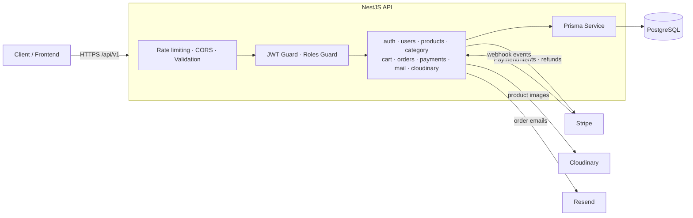
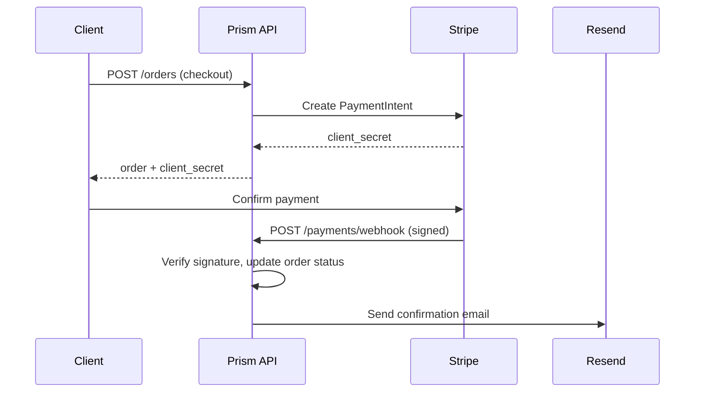

# Prism — E-commerce API

A RESTful backend for an e-commerce platform, built with NestJS, TypeScript, PostgreSQL, and Prisma.

Prism provides the core backend capabilities of an online store, including authentication, catalog management, shopping carts, order processing, and payment integration. The project emphasizes modular architecture, input validation, access control, and automated testing.

## Features

- **Authentication and authorization:** JWT access and refresh tokens, protected routes, and role-based access control.
- **Catalog management:** Product and category CRUD operations.
- **Shopping cart:** Cart management and checkout workflows.
- **Order management:** Order creation, status tracking, and inventory updates.
- **Payments:** Stripe PaymentIntents, payment confirmation, webhook handling, and refunds.
- **Media uploads:** Cloudinary integration for product images.
- **Transactional email:** Resend integration for order-related notifications.
- **API documentation:** Interactive Swagger/OpenAPI documentation.
- **API protection:** Request validation, CORS configuration, and rate limiting.
- **Automated tests:** Jest unit tests for controllers and services.

## Architecture



## Tech Stack

| Area              | Technology            |
| ----------------- | --------------------- |
| Framework         | NestJS                |
| Language          | TypeScript            |
| Database          | PostgreSQL            |
| ORM               | Prisma                |
| Authentication    | JWT, Passport, bcrypt |
| Payments          | Stripe                |
| Image storage     | Cloudinary            |
| Email             | Resend                |
| API documentation | Swagger / OpenAPI     |
| Testing           | Jest, Supertest       |

## Getting Started

### Prerequisites

- Node.js 20 or later
- npm
- PostgreSQL
- Stripe, Cloudinary, and Resend credentials for the integrations you want to use

### Installation

```bash
npm install
```

Create a `.env` file in the project root and configure the environment variables required by the application.

```env
DATABASE_URL="your-database-connection-string"
PORT=3000
CORS_ORIGIN="http://localhost:3001"

JWT_SECRET="your-access-token-secret"
JWT_REFRESH_SECRET="your-refresh-token-secret"

STRIPE_SECRET_KEY="sk_test_..."
STRIPE_WEBHOOK_SECRET="whsec_..."

CLOUDINARY_CLOUD_NAME="your-cloud-name"
CLOUDINARY_API_KEY="your-api-key"
CLOUDINARY_API_SECRET="your-api-secret"

RESEND_API_KEY="re_..."
MAIL_FROM="noreply@example.com"
```

Use valid credentials for your environment. Never commit real secrets to version control.

### Database Setup

Generate the Prisma client:

```bash
npm run prisma:generate
```

Apply database migrations using the migration workflow configured for this project.

### Run the API

```bash
# Development
npm run start:dev

# Production build
npm run build
npm run start:prod
```

By default, the API listens on port `3000`, subject to your environment configuration.

## API Documentation

When the application is running, open Swagger at:

`http://localhost:3000/api/docs`

API routes use the `/api/v1` prefix. Example endpoints include:

```text
POST /api/v1/auth/login
GET  /api/v1/products
```

Protected endpoints require a valid access token:

```text
Authorization: Bearer <access-token>
```

The `requests/` directory contains example HTTP requests for selected API workflows.

## Payments and Webhooks

Prism integrates with Stripe PaymentIntents and processes payment-related webhook events.

For local development, configure Stripe CLI or another supported webhook-forwarding method to send events to:

`POST /api/v1/payments/webhook`

Set `STRIPE_WEBHOOK_SECRET` to the signing secret for the configured endpoint. Use Stripe test credentials during development.



## Testing

Run the unit test suite:

```bash
npm test -- --runInBand
```

Run end-to-end tests:

```bash
npm run test:e2e
```

Generate a coverage report:

```bash
npm run test:cov
```

The current unit test baseline is **192 passing tests across 16 test suites**, with **70.62% line coverage**. Coverage figures may change as the codebase evolves.

## Project Structure

```text
src/
  common/       Shared decorators, guards, and utilities
  modules/
    auth/       Authentication and token management
    users/      User management
    products/   Product catalog
    category/   Category management
    cart/       Shopping cart
    orders/     Order workflows
    payments/   Stripe integration and webhooks
    cloudinary/ Image upload integration
    mail/       Transactional email
  prisma/       Database service

prisma/         Database schema and migrations
requests/       Example HTTP requests
test/           End-to-end tests
```

## Useful Commands

```bash
npm run format
npm run lint
npm run build
npm run test:cov
```

## Engineering Focus

This project demonstrates modular backend development, authentication and authorization, relational data modeling, payment workflow integration, error handling, and automated testing.
